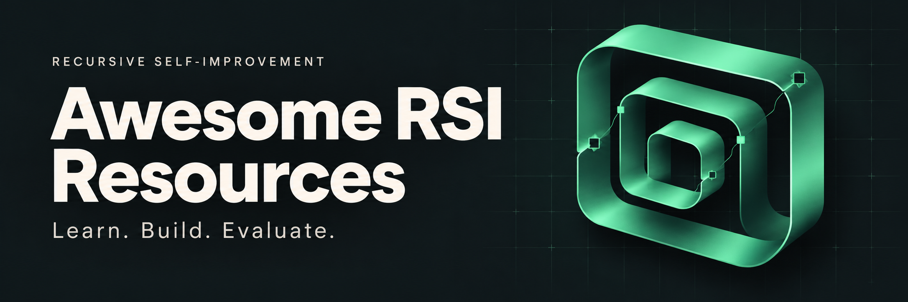

<h1 align="center" id="awesome-rsi-resources">
  
</h1>

  <strong>从研究论文到可运行的改进循环。</strong> 
  递归自我改进的综述、教程与实践项目，附推荐学习入口和运行条件。

  <a href="README.md">English</a> · <strong>简体中文</strong>

  
  
  

  <a href="#start-here"><strong>快速开始</strong></a> &nbsp;·&nbsp;
  <a href="docs/learning-guide_zh.md">学习指南</a> &nbsp;·&nbsp;
  <a href="docs/practice-guide_zh.md">实践指南</a> &nbsp;·&nbsp;
  <a href="docs/verification_zh.md">核验档案</a>

**收录 77 项资源；最近一次来源核验：2026-10-29。** 同一项目的网站、代码和 Notebook 合并计数；各项日期与实际核验范围见[核验档案](docs/verification_zh.md)。

## 资源范围与分类

本目录同时覆盖递归改进，以及学习它所需的机制和工具。以下标签针对**推荐的具体实践入口**及其已展示的范围，参考 [Modern Agentic Systems §3.2](https://arxiv.org/html/2607.13104v1#S3.SS2) 与 [The Last AI §§2.2–2.3](https://arxiv.org/html/2609.11873v3#S2.SS2)，是本目录的学习分类；不同论文采用的定义有所区别。

| 分类 | 入口所讲授的内容 | 本目录示例 |
| --- | --- | --- |
| **递归改进方法** | 保留对 Agent 实现或改进策略的修改，并将其用于后续改进工作。区分教学原型与研究实现；标签本身不代表已实现持续加速。 | [RSI Labs](#rsi-labs)：小型改进策略实验；[STOP／SICA](#recursive-methods)：追踪可执行实现的继承；[Harness²](#harness2)／[HyperAgents](#hyperagents)：改进器经验或元 Agent 代码；[DGM](#dgm)：继承的 Agent 代码参与后续自修改。 |
| **相关自改进机制** | 提示词优化、程序搜索、学习适应策略、经验复用或协同适应，也包括入门构件与模拟演示。条目说明改变什么、哪些部分保持固定。 | [Meta-Harness／AHO](#harness-optimization)、[GEPA / TextGrad](#tutorials)、[ShinkaEvolve / SEAL / Agent Lightning](#practice)、[ACE / Voyager](#memory-skills)、[协同演化](#coevolution-projects)与[自博弈](#adversarial-self-play)。 |
| **评测工具** | 衡量组件表现、跨会话保留的收益或 AI 研究任务表现，也包括验收门控教学示例。 | [LongMemEval-V2](#longmemeval-v2)、[PAST-Bench](#past-bench)、[Scale RSI Bench](#scale-rsi-bench) 与 [RSI Atlas](#rsi-atlas)。 |

索引、综述、教材与综合课程仍作为阅读资源，可以横跨多类。记忆评测或固定优化器教程可以为 RSI 学习提供准备，其本身未必展示递归改进循环。需要基础时可先学[前置课程](#prerequisite-courses)，再比较下文的具体机制。

## 快速开始

| 目标 | 推荐入口 |
| --- | --- |
| 建立概念框架 | [Prism 中文导读](#prism) → [RL 与 RSI 的区别](#rl-and-rsi) → [综述阅读路线](docs/learning-guide_zh.md#survey-reading-path) |
| 用中文和代码入门 | [Hello-Agents Reflection](#hello-agents) → [李宏毅自我成长讲次](#hung-yi-lee)；需要系统基础时选 [WalkingLabs](#walkinglabs) |
| 理解递归改进 | [RSI Labs 第 4 节](#rsi-labs) → [STOP / SICA 源码路线](#recursive-methods) → [DGM](#dgm) 或 [HyperAgents](#hyperagents) |
| 做 Agent 工程与优化 | [Harness 构件教程](#learn-deepseek-harness) → [Harness² 流程演示](#harness2)，再按目标选择 [Harness 优化](#harness-optimization)或[程序搜索](#program-search) |
| 进入训练与研究 | [Stanford CS329A](#cs329a) → [模型训练项目](#model-training)；按研究目标选[协同演化](#coevolution-projects)或[自博弈](#adversarial-self-play) |
| 学习经验复用与评测 | [ACE / Voyager](#memory-skills) → [LongMemEval-V2](#longmemeval-v2) → [PAST-Bench](#past-bench) 跨会话评测；验收门控入门可看 [RSI Atlas](#rsi-atlas) |

深入阅读：[学习指南](docs/learning-guide_zh.md)（阅读路线与项目映射） · [实践指南](docs/practice-guide_zh.md)（源码、运行入口与完整条件） · [核验档案](docs/verification_zh.md)（日期、覆盖与来源依据）。

## 目录

- [研究索引与 Awesome 清单](#indexes)
- [综述与阅读路线](#surveys)
- [RL 与 RSI](#rl-and-rsi)
- [学习材料](#learning-materials)
  - [指南与教材](#guides)
  - [前置课程](#prerequisite-courses)
  - [实践教程](#tutorials)
  - [课程与工作坊](#courses)
  - [中文视频与报告](#videos)
- [实践项目](#practice)
  - [程序搜索](#program-search)
  - [Agent 与改进器代码](#recursive-methods)
  - [Harness 优化](#harness-optimization)
  - [模型训练](#model-training)
  - [记忆与技能](#memory-skills)
  - [协同演化](#coevolution-projects)
  - [对抗式自博弈](#adversarial-self-play)
- [评测工具](#evaluation)
- [核验与贡献](#verification)

## 研究索引与 Awesome 清单

这一类适合找相关工作、比较研究方向和制定阅读顺序。各项目采用自己的 RSI 定义与分类框架，学习时可以互相对照。

| 资源 | 特色与学习目标 | 推荐学习入口 | 语言与条件 |
| --- | --- | --- | --- |
|  [Prism-Shadow/awesome-rsi](https://github.com/Prism-Shadow/awesome-rsi) | 用九个维度组织方法与评测，配有双语图解、论文筛选和引用图谱；适合先建立全景框架。 | 先读[中文 RSI 导读](https://github.com/Prism-Shadow/awesome-rsi/blob/main/site/src/data/blog/rsi-guide.zh.md)，再到[网站](https://prism-shadow.github.io/awesome-rsi/#blog/understanding-rsi)查方法与评测。 进阶读其[作者公开综述](https://github.com/Prism-Shadow/awesome-rsi/blob/main/site/public/papers/rsi-survey.pdf)：§2.3 闭环 → §3 分类 → §4 与深度学习的联系 → §5 评估。 | 中英导读、英文综述；基础 LLM / Agent 概念；纯阅读。 |
|  [natnew/awesome-recursive-self-improvement](https://github.com/natnew/awesome-recursive-self-improvement) | 将领域地图与入门、系统构建、安全与边界三条路线结合，适合把零散论文串成阅读顺序。 | [Reading Paths](https://github.com/natnew/awesome-recursive-self-improvement#reading-paths)，先选一条路线再进入主题目录。 | 英文；LLM / 机器学习基础；纯阅读。 |
|  [lobehub/awesome-rsi](https://github.com/lobehub/awesome-rsi) | 覆盖模型、Harness、记忆、多 Agent、具身和自动 AI 研究；解释任务收益、保留收益和改进器收益等不同证据层级。 | [Fundamentals & Getting Started](https://github.com/lobehub/awesome-rsi#fundamentals--getting-started) → [Scope & Terminology](https://github.com/lobehub/awesome-rsi#scope--terminology)。 | 英文；LLM / Agent 基础；纯阅读。 |
|  [Persdre/awesome-recursive-self-improvement](https://github.com/Persdre/awesome-recursive-self-improvement) | 以“修改对象 × 闭环程度”整理研究，适合辨析不同工作所说的 RSI。 | [What Counts as RSI?](https://github.com/Persdre/awesome-recursive-self-improvement#what-counts-as-rsi)，再按修改对象查论文。 | 英文；机器学习 / Agent 背景；其中层级标签是作者的整理框架。 |
|  [Token-Rhythm/awesome-rsi](https://github.com/Token-Rhythm/awesome-rsi) | 双语文献表带日期、主题标签、摘要和论文 / 代码入口，适合按方向查阅。 | [中文精选读物](https://github.com/Token-Rhythm/awesome-rsi/blob/main/README_zh.md#featured-rsi-readings) → [分类概览](https://github.com/Token-Rhythm/awesome-rsi/blob/main/README_zh.md#category-overview)。 | 中英；纯阅读。上游最近核验标为 **2026-08-13**，9–10 月资料宜结合其他目录查阅。 |
|  [jacky-leng/awesome-rsi](https://github.com/jacky-leng/awesome-rsi) | 用闭环位置、反馈、搜索、持久状态、人的角色和证据类型六个轴比较改进循环，适合做方法对照。 | [TAXONOMY.md](https://github.com/jacky-leng/awesome-rsi/blob/main/TAXONOMY.md) → [Landscape](https://github.com/jacky-leng/awesome-rsi#landscape)。 | 英文；纯阅读。上游标注核验覆盖至 **2026-10-07**。 |
|  [pinkbubblebubble/awesome-rsi](https://github.com/pinkbubblebubble/awesome-rsi) | 用 RSI / Self-improvement / Enabler 标签解释资源与递归改进的关系，兼收 Harness、评测和工程报告，适合寻找近期实践方向。 | [Scope and labels](https://github.com/pinkbubblebubble/awesome-rsi#scope-and-labels) → [Start here](https://github.com/pinkbubblebubble/awesome-rsi#start-here)；实践可看 [Harness 清单](https://github.com/pinkbubblebubble/awesome-rsi#self-improvement-harnesses)。 | 英文；纯阅读。上游自报最近核验 **2026-10-26**；第三方实现各有运行条件。 |
|  [Follow RSI](https://adongwanai.github.io/follow-rsi/index.html) · [仓库](https://github.com/adongwanai/follow-rsi) | 聚焦 Harness 自进化的论文索引，提供阅读路线，以及留出评测、同预算对照、迁移和成本等证据卡片，适合学习怎样判断改进主张的依据。 | [中英 Harness 导读](https://adongwanai.github.io/follow-rsi/guide.html) → [阅读路线](https://adongwanai.github.io/follow-rsi/index.html#routes) → [日报状态](https://adongwanai.github.io/follow-rsi/daily/index.html)。 | 中文与英文；只读学习。多数证据字段仍为 `unknown`（尚未审定）；核验时订阅 Skill 已预告但尚未实现。10-27 日报已撤回，[10-28 复核](docs/verification_zh.md#verification-2026-10-28)时 feed 为空。 |

## 综述与研究总览

精选有明确章节入口的综述；论文采用各自的定义与分类框架。完整版本与索引覆盖记录见下方专题链接。

| 资源 | 特色与学习目标 | 推荐学习入口 | 语言与条件 |
| --- | --- | --- | --- |
|  [selfimproving-agent/Awesome-Self-Improving-Agents](https://github.com/selfimproving-agent/Awesome-Self-Improving-Agents) · [论文](https://arxiv.org/abs/2607.13104) | 综述配套资源，将模型参数改进与 prompt、记忆、工具、完整 scaffold 改进分开，并提供评测和应用领域索引。 | 读[§3 定义 → §4 分类 → §5 模型／§6 scaffold 改进 → §8 评估](https://arxiv.org/html/2607.13104)，再用 [Agent-oriented guide](https://github.com/selfimproving-agent/Awesome-Self-Improving-Agents/blob/main/README_AGENT.md) 按问题定位章节。 | 英文；机器学习 / Agent 基础；纯阅读，含论文源码。 |
|  [deepgrounding/recursive-self-improvement](https://github.com/deepgrounding/recursive-self-improvement) · [论文](https://arxiv.org/abs/2607.07663) | 综述配套仓库，提供冻结文献语料、分类脚本、图表和参考文献生成流程；把部署期改进、训练、自评估与自动研究放在同一分类框架中。 | 先读[综述源码](https://github.com/deepgrounding/recursive-self-improvement/blob/main/draft/main.md)的 §2 与 §5，再看 [Reproducing](https://github.com/deepgrounding/recursive-self-improvement#reproducing)和[语料文件](https://github.com/deepgrounding/recursive-self-improvement/blob/main/artifacts/corpus_v2.csv)。 | 英文；复现需 Python 3.11+、NumPy、Matplotlib，部分脚本访问 arXiv / OpenAlex。语料冻结于 **2026 年 7 月**，9 月公开发布。 |
|  [Self-Improvement of Large Language Models: A Technical Overview and Future Outlook](https://arxiv.org/abs/2603.25681) · [作者仓库](https://github.com/Zesearch/self-improvement-llm) | 按数据获取、筛选、模型优化、推理改进和自主评估组织模型自改进，适合把分散技术串成完整学习周期。 | 先读[论文引言和 §4](https://arxiv.org/html/2603.25681v3)，重点比较 §4.3–4.4 的自生成优化与自进化优化，再读 §6 自主评估。 | 英文；需要机器学习／LLM 训练背景。TMLR 综述；已核验 v3 定稿版。 |
|  [A Survey of Self-Evolving Agents: What, When, How, and Where to Evolve](https://arxiv.org/abs/2507.21046) · [CharlesQ9/Self-Evolving-Agents](https://github.com/CharlesQ9/Self-Evolving-Agents) | 比较更新什么、何时适应，以及反馈和种群如何驱动更新；尤其适合区分任务内适应与跨任务学习。 | [§2 定义 → §3–5 分类 → §7 评估](https://arxiv.org/html/2507.21046v4)，选好分支后再从配套列表找实现。 | 英文；需要 Agent／机器学习基础。TMLR 2026；已核验 v4，论文版本晚于配套 README 最近的内容更新。 |
|  [A Comprehensive Survey of Self-Evolving AI Agents](https://arxiv.org/abs/2508.07407) · [ANative-Lab/Awesome-Self-Evolving-Agents](https://github.com/ANative-Lab/Awesome-Self-Evolving-Agents) | 用系统输入、Agent 系统、环境和优化器说明优化闭环，再区分单 Agent、多 Agent 与领域专用优化。 | 先读[§3 与图 3](https://arxiv.org/pdf/2508.07407v2#page=9)，再读 §4–5 方法和 §7 评估。 | 英文；需要 Agent／优化基础。原 EvoAgentX 仓库地址已跳转至 ANative-Lab，合并为一项资源。 |
|  [Self-Improving Agents in the Era of Experience: A Survey of Self- to Meta-Evolution](https://github.com/FrontisAI/Awesome-Self-Improving-Agents) | 沿部署轨迹到可复用技能、持久记忆、环境、模型更新与元层控制组织内容，连接 Harness 工程与经验驱动改进。 | 从[作者公开 PDF](https://github.com/FrontisAI/Awesome-Self-Improving-Agents/blob/main/Self_Improving_Agents.pdf) 的 §2（第 5 页）开始，再读 §3–4 与 §7–8；再看姜澈的中文[青稞 Talk 146 录像](https://www.bilibili.com/video/BV13ZgA64Ept/)与[主办方提纲](https://www.qingkeai.online/blog/AI4AI-RSI)。 | 英文论文、中文讲座；需要 Agent／LLM 基础。正文和结构通过作者 PDF 核验；2026-10-22 核验时 OpenReview 返回浏览器验证页。 |
|  [The Last AI Built by Humans: Toward Genuine Recursive Self-Improvement](https://arxiv.org/abs/2609.11873) · [theseus-labs-rsi/awesome-rsi](https://github.com/theseus-labs-rsi/awesome-rsi) | 综述与路线图：比较执行、改进策略、未来经验获取、部署适应和改进机制本身的自主性，并连接应用领域与产业案例。 | [§2.2 改进闭环定义 → §3 自主性层级](https://arxiv.org/html/2609.11873v3)，再使用配套仓库的 [Start Here](https://github.com/theseus-labs-rsi/awesome-rsi#start-here)。 | 英文；需要 Agent／机器学习背景。L1–L5 是该论文的组织框架，不是全领域统一标准；产业案例属于作者报告的证据。 |
|  [Co-Evolution in Agentic Systems: Toward Self-Directed Evolution Beyond Human Design](https://arxiv.org/abs/2608.10299) | 聚焦互相适应的 Agent、环境与进化机制，解释协同进化相对固定学习情境的改进闭环增加了什么。 | [§2.2–2.3 定义与三阶段地图 → §3–5](https://arxiv.org/html/2608.10299v1)，附录 A 区分协同进化与相邻概念。 | 英文；需要多 Agent／强化学习基础。综述与概念路线图；元协同进化仍作为新兴方向讨论。 |
|  [Self-Evolving Coding Agents](https://arxiv.org/abs/2608.03392) | 按资产、架构和模型参数整理代码 Agent 的持久更新，并梳理代码特有反馈与评估；有助于区分改进当前任务代码与改进未来解题 Agent。 | [§2.3 操作性边界 → §3 分类 → §7–8 反馈与评估](https://arxiv.org/html/2608.03392v4)。 | 英文；需要代码 Agent／软件工程基础。已核验 v4；属于阅读材料，不是可运行教程。 |
|  [Safety in Self-Evolving Agents: A Survey](https://arxiv.org/abs/2610.00093) · [作者仓库](https://github.com/xaddwell/awesome-self-evolving-agent-safety) | 研究经验成为可复用记忆、技能、工具、工作流或模型状态后，安全属性如何变化；SAVER 串起状态载体、适应操作、违规、暴露与响应。 | 先读[§2.3–2.4：状态转移检查与 SAVER](https://arxiv.org/html/2610.00093v1)，再读配套仓库的 [Overview 与 Corpus](https://github.com/xaddwell/awesome-self-evolving-agent-safety#overview)。 | 英文；需要 Agent／安全背景。配套语料含机器初始化标签与置信度分级，不能视为全部经人工核验的书目。 |
|  [Towards AI That Improves Itself: A Survey of Recursive Self-Improvement](https://lee1003-lee.github.io/Awesome-RSI-Research/) · [作者仓库](https://github.com/Lee1003-lee/Awesome-RSI-Research) | 区分“继承已有改进”与“改进机制本身变强”，并关联验证、更新策略和记忆复用。适合学习如何设计与评估持续改进闭环。 | 先读 [§3 定义与主张检验框架](https://lee1003-lee.github.io/Awesome-RSI-Research/assets/rsi-survey.pdf#page=5)，再读 §4.3（第 14 页）及 §5.2（第 21 页），了解更新与智能体系统演化。 | 英文；需智能体 / 机器学习基础。相关区分属于作者框架；文献表也包含为 RSI 提供支持的相邻方法。作者公开的综述稿件。 |
|  [From Harness Optimization to Recursive Self-Improvement: A Survey of Language Model Agents](https://lucasxinyu.github.io/harness-rsi/paper/) · [作者仓库](https://github.com/LucasXinYu/harness-rsi) | 将改进流程、递归范围与代码、推理、交互和视觉任务中的具体 Harness 修改相连接；配套图谱追踪初始行为、实际改动、结果与复用条件。 | 读 [10 月 27 日作者 PDF](https://github.com/LucasXinYu/harness-rsi/blob/7f846c52fe70338ee97584c33c06f7ec99f67ed5/docs/paper/Harness_RSI_Preprint_2026-10-27.pdf)：§2.1（第 3 页）→ §3.2（第 6 页）→ §§4.5–5（第 10 页）；再看[机制对照](https://github.com/LucasXinYu/harness-rsi#compare-the-mechanisms)。 | 英文；Agent 工程基础；纯阅读。作者修订版 **2026-10-27**，与 **10-23** 发布的 Preprints.org v1 分开；尚未经同行评审。 |

**[推荐综述阅读路线](docs/learning-guide_zh.md#survey-reading-path)**：入门总览 → 方法进阶；持续自改进的可靠性与安全控制为可选分支。

**[从综述到实践项目](docs/learning-guide_zh.md#survey-project-map)**。

**[近期综述覆盖表](docs/verification_zh.md#survey-coverage)**。

## RL 与 RSI：关系、区别和阅读路线

**RL 是从奖励中学习行为的方法；RSI 关注保留下来的改进怎样参与后续改进。** 两者存在交集，但描述的是系统的不同方面。已有文献直接讨论这层关系：先读 [Modern Agentic Systems §§3.2–3.3](https://arxiv.org/html/2607.13104v1#S3.SS3)，再对照 [Towards AI §3](https://lee1003-lee.github.io/Awesome-RSI-Research/assets/rsi-survey.pdf#page=5) 的定义。一些框架纳入自生成训练循环，更强的主张则要求改进器自身得到改进。下表是本目录的整理，不代表统一等级体系，也不意味着所有 RL 都采用固定架构。

| 机制 | 哪些部分变化 | 从示例中学习什么 |
| --- | --- | --- |
| 策略学习 | 在给定更新流程下改变策略参数 | [Agent Lightning](#agent-lightning)：追踪 rollout → 奖励 → checkpoint。任务奖励提高本身不能说明更新流程也变好了。 |
| 对抗式自博弈 | 策略，以及彼此形成的对手和经验 | [OpenSpiel 与 SPIRAL](#adversarial-self-play)：观察自适应学习信号。自博弈说明经验怎样产生，本身不指定使用 RL、偏好优化，或是否改写学习规则。 |
| 学习 RL 更新规则 | 用来训练其他 Agent 的参数化规则 | 下方 DiscoRL：对比“学到更好的策略”与“学会怎样更新策略”。学习到更新规则不等于发现规则的过程也会自行改写。 |
| 系统联合改进 | 可复用的 Harness 流程与模型权重 | 下方 ScienceBuddy：Harness 改进影响下一轮 RL，更新后的模型又改变后续 Harness 适应。 |
| 自修改学习机制 | 能修改自身学习行为的策略程序 | 下方 Schmidhuber 的 self-modifying policies：研究如何为影响后续修改的自修改分配信用。 |

因此，RL 可以承担 RSI 循环中的一部分更新，代码搜索或保留的技能编辑也可以提供其他更新；[DGM](#dgm) 可作为没有 RL 权重训练步骤的对照。读项目时辨认**哪些变化被保留、下一轮信号由谁产生、更新流程本身是否变化**。要研究改进器的收益，可在相近任务与预算下，对照保留和不保留该变化时的后续学习效果。

**推荐顺序：** Modern Agentic Systems §3.3 → 已收录的 [Ashish Kumar 第二篇](https://ashishkumar.ai/blog/self-improving-ai-self-play-self-training/)（先读 self-play template，再读 Learning to learn）→ 任选一个自博弈实践项目 → 下方三项读物。研究阅读本身无需运行，项目表另列实际运行条件。

| 资源 | 特色与学习目标 | 推荐学习入口 | 语言与条件 |
| --- | --- | --- | --- |
|  [Schmidhuber：Recursive Self-Improvement (RSI) Since 1987](https://people.idsia.ch/~juergen/recursive-self-improvement.html) | 作者回顾能修改自身学习流程的策略，让更强的“改进改进器”含义具体化；定义与历史叙述属于作者视角。 | [§2 自修改策略](https://people.idsia.ch/~juergen/recursive-self-improvement.html#secSMP) → [§7 近期工作](https://people.idsia.ch/~juergen/recursive-self-improvement.html#secLouis)，再读链接的 [1997 年章节](https://people.idsia.ch/~juergen/ssabook/ssabook.html)中的形式化概念。 | 技术笔记：**2026 年 9 月**；英文；RL 与算法基础。历史／概念阅读，不是现代环境安装教程。 |
|  [DiscoRL：Discovering state-of-the-art reinforcement learning algorithms](https://www.nature.com/articles/s41586-025-09761-x) | 通过元优化学习 RL 更新规则，再用该规则训练新 Agent，连接策略改进与训练机制改进。 | [作者图解项目页](https://google-deepmind.github.io/disco_rl/)的 Method → 论文 Figure 1、Discovery method / Meta-optimization → Generalization。 | Nature 首发 **2025-10-22**，正式版 **2025-11-26**。英文；RL、神经网络与元梯度基础。作为阅读入口，未审计代码／复现配置。 |
|  [ScienceBuddy: Recursive-in-Recursive Self-Improvement for Interactive Scientific Agents](https://arxiv.org/abs/2609.17523) | 跨轮次结合 Harness 编辑与模型 RL；辅助编辑器与 GRPO 规则保持固定，便于辨认真正变化的组件。 | [§§2.3–2.5 与 Algorithm 1](https://arxiv.org/html/2609.17523v1#S2.SS3) → §4.2 的双轮次研究。 | arXiv **v1，2026-09-15**。英文；Agent 架构与 RL 基础。论文阅读，未独立复现产品、代码及实验结果。 |

## 学习材料

### 指南、教材与学习路径

| 资源 | 特色与学习目标 | 推荐学习入口 | 语言与条件 |
| --- | --- | --- | --- |
|  [The RSI Book · bhavsarpratik/rsi](https://github.com/bhavsarpratik/rsi) | **相关自改进机制。** 用评估、提示修改和经验复用搭建第一个 Python 改进循环。 | [第 2 章与 Notebook](docs/practice-guide_zh.md#rsi-book) | 英文；Python 3.10+、LiteLLM、模型接口。 |
|  [Roloria/rsi-learn](https://github.com/Roloria/rsi-learn) | **相关自改进机制。** 中文学习路线与基于规则的进化搜索模拟，适合建立闭环直觉。 | [学习路线与本地实验场](docs/practice-guide_zh.md#rsi-learn) | 中文；Node.js / Vite；模拟不调用模型。 |
|  [Ashish Kumar：Recursive self-improvement 三篇导读](https://ashishkumar.ai/series/recursive-self-improvement/) | 从理论基础讲到 self-play / self-training，再到自修改代码；包含 text-to-SQL 自训练循环示意与评估 Harness 讨论。 | 按顺序读 [Part 1：概念与理论](https://ashishkumar.ai/blog/recursive-self-improvement-explained/)、[Part 2：自博弈与自训练](https://ashishkumar.ai/blog/self-improving-ai-self-play-self-training/)、[Part 3：自修改代码](https://ashishkumar.ai/blog/self-improving-code-alphaevolve-to-aide/)。 | 英文；适合有 LLM / 机器学习基础的读者。**2026-10-11** 发布的解释性文章，代码段用于讲解。 |
|  [RSI 研究札记 · asimfish/awesome_rsi](https://github.com/asimfish/awesome_rsi) | 中文论文精读与综合分析，对照模型权重、Harness 代码和文本技能等改进方式，重点讨论评估；适合从领域概览进入单篇论文。 | 按 [Start Here](https://github.com/asimfish/awesome_rsi#1-start-here) 选择路线，先读[报告 10：汇总洞察](https://github.com/asimfish/awesome_rsi/blob/main/reports/10_synthesis_insights.md)，再读[报告 12：自进化 Agent 综述](https://github.com/asimfish/awesome_rsi/blob/main/reports/12_self_evolving_agents_survey.md)。学习 Harness 优化时可先读[报告 13 第 4 节：Meta-Harness](https://github.com/asimfish/awesome_rsi/blob/63f83e581ff3161932b62ab5fbe845fdf03cf84b/reports/13_meta_harness.md)，再进入[官方代码入口](#harness-optimization)。 | 中文；LLM / Agent 基础；纯阅读。报告包含整理者的分析；配套论文中译为机器翻译，引用与技术细节应回到论文原文。 |
|  [Lilian Weng：Harness Engineering for Self-Improvement](https://lilianweng.github.io/posts/2026-07-04-harness/) | 串联上下文管理、工作流搜索、自修改 Harness、进化搜索及 Harness／权重联合更新的研究长文，适合对照本目录实践项目背后的机制。 | 从 [Harness Optimization](https://lilianweng.github.io/posts/2026-07-04-harness/#harness-optimization) 开始，重点读 Self-Improving Harness 与 Evolutionary Search，再读 Future Challenges。 | 英文；Agent 与评估基础；纯阅读。属于综述性技术博客，与经过同行评审的综述论文分开标注。 |

### 前置课程

这门可选课程帮助理解 Agent 改进所需的构件，再进入递归方法示例。已经收录的 [Hello-Agents 与 Harness 教程](#tutorials)提供更短的入门路线。

| 资源 | 特色与学习目标 | 推荐学习入口 | 语言与条件 |
| --- | --- | --- | --- |
|  [WalkingLabs：Self-Improving Agent Notebook](https://github.com/walkinglabs/self-improving-agent-notebook) | **相关自改进机制。** 双语 Notebook 讲解 Agent 循环、评估、代码搜索与归档；参考 CS329A 的社区前置课程。 | [L01 基础 → L07 代码搜索](docs/practice-guide_zh.md#walkinglabs) | 中英；Python、Jupyter 与模型 API；可选前置。 |

### 实践教程

| 资源 | 特色与学习目标 | 推荐学习入口 | 语言与条件 |
| --- | --- | --- | --- |
|  [RSI Labs · weilinear/rsi_labs](https://github.com/weilinear/rsi_labs) | **递归改进方法。** 教学原型修改改进器指令，评估其后续修复选择。 | [Notebook 第 4 节与配置](docs/practice-guide_zh.md#rsi-labs) | 英文；Colab / Jupyter、Google API key；无需训练 GPU。 |
|  [Prism-Shadow/learn-deepseek-harness](https://github.com/Prism-Shadow/learn-deepseek-harness) | **相关自改进机制。** 分课实现 Agent Harness 构件，再观察运行时自修改。 | [L1 Agent 循环 → L10 自修改](docs/practice-guide_zh.md#learn-deepseek-harness) | 中英；Node.js、TypeScript 与 DeepSeek API。 |
|  [GEPA / DSPy 官方教程](https://github.com/gepa-ai/gepa) | **相关自改进机制。** 用文本反馈、候选选择与持出评估优化可复用提示。 | [DSPy AIME Notebook](docs/practice-guide_zh.md#gepa) | 英文；Python 与模型 API；不训练权重。 |
|  [TextGrad 官方 Notebook](https://github.com/zou-group/textgrad) | **相关自改进机制。** 用文本梯度优化共享提示，观察按验证结果回退更新。 | [Primitives → 物体计数 Notebook](docs/practice-guide_zh.md#textgrad) | 英文；Python 与模型 API。 |
|  [Datawhale Hello-Agents：Reflection 与自进化](https://github.com/datawhalechina/hello-agents) | **相关自改进机制。** 通过中文讲解与代码学习生成、评审、修改的反思循环。 | [第四章 §4.4 → Extra10](docs/practice-guide_zh.md#hello-agents) | 中文；真实推理需 Python 与模型 API。 |
|  [Datawhale Hello Generic Agent](https://github.com/datawhalechina/hello-generic-agent) | **相关自改进机制。** 将任务经验整理成后续会话可发现、可复用的 SOP 和脚本。 | [第 4、12 章与安装入口](docs/practice-guide_zh.md#hello-generic-agent) | 中文；推荐 Python 3.11/3.12、模型 API 及所选工具依赖；Beta。 |

### 课程与工作坊

| 资源 | 特色与学习目标 | 推荐学习入口 | 语言与条件 |
| --- | --- | --- | --- |
|  [Stanford CS329A：Self-Improving AI Agents](https://cs329a.stanford.edu/) | 系统串联 test-time compute、verifier、工具反馈、规划、RL、开放式演化和 Agent 评测，适合按周安排阅读。 | 官网 Schedule 的**第 2–7 讲**建立基础，再读**第 17 讲 Agentic Evaluations & Long-Horizon Tasks**。 | 英文；机器学习 / LLM 基础。当前公开页面为 **2025 秋季课程**，已核验课程表与论文阅读清单。 |
|  [Harvard CS 2881R：AI Safety 中的 RSI 专题](https://boazbk.github.io/mltheoryseminar/) | 从 AI 研发自动化、改进速度和安全视角理解 RSI，适合补充技术实现之外的研究问题。 | [2025-10-09 归档讲](https://boazbk.github.io/mltheoryseminar/fall2025/#lecture-oct-9)有课件、总结和录影入口；再看 [2026-09-24 RSI & AI Trajectories](https://boazbk.github.io/mltheoryseminar/#lecture-sep-24)的阅读与学生实验材料。 | 英文；机器学习、概率 / 信息论与 Python 基础。属于 AI Safety 课程中的专题；2026 该讲当前未列录影。 |
|  [ICLR 2026：AI with Recursive Self-Improvement Workshop](https://recursive-workshop.github.io/) | 集中呈现自改进方法、系统与评测的研究议题，适合从议程进入具体研究工作。 | 先看官网议程与主题，再从 [Accepted Papers](https://recursive-workshop.github.io/papers.html)的 Oral / Spotlight 选论文。 | 英文；研究背景更有帮助。活动日期 **2026-04-26**；已核验官网与论文集。 |
|  [DeepLearning.AI × Oracle：Building Adaptive AI Agents](https://www.deeplearning.ai/courses/building-adaptive-ai-agents) | 讲解三层适应：从 Agent 轨迹提炼可复用技能、代码图检索和模型适应。适合学习如何跨会话保留经验；提炼出的技能需要人工批准。 | 先看 Overview of Continual Learning，再学 [Behavior Adaptation: Trajectory-to-Skill Learning](https://learn.deeplearning.ai/courses/building-adaptive-ai-agents/lesson/9i82mn/behavior-adaptation%3A-trajectory-to-skill-learning)，然后进入代码图相关课程。 | 英语；建议具备 Python 基础。课纲列有 7 个视频和 3 个代码示例；Free 计划可看视频，动手实验与评分活动属于 Pro。 |
|  [Berkeley Advanced LLM Agents MOOC：自改进相关讲次](https://llmagents-learning.org/sp25) | 将自奖励、迭代偏好优化和元奖励与 LLM 推理相连接，适合学习模型如何生成训练信号并改进自身判断。 | 从 Jason Weston 的 **2025-02-03** 讲次 *Learning to reason with LLMs* 及[讲义第 40 页](https://rdi.berkeley.edu/llm-agents-mooc/slides/Jason-Weston-Reasoning-Alignment-Berkeley-Talk.pdf#page=40)开始，再读课纲中的迭代推理偏好优化论文。 | 英语；建议具备 LLM 与后训练基础。**Spring 2025** 课程已结束，仍有公开讲义与阅读材料，另列有录像入口。 |

### 中文视频课程与研究报告

经验驱动的自进化到元进化中文作者讲座，可看青稞 Talk 146；它与 FrontisAI 论文合并放在[综述与研究总览](#surveys)，不重复计数。

| 资源 | 特色与学习目标 | 推荐学习入口 | 语言与条件 |
| --- | --- | --- | --- |
|  [李宏毅：机器学习 2026 — 自我成长专题](https://speech.ee.ntu.edu.tw/~hylee/ml/2026-spring.php) | 中文讲解串联答案修正、自生成训练信号、Harness 优化以及“学习如何改进”。配套讲义区分输出、提示词／代码与模型参数的变化，适合建立方法之间的联系。 | 按顺序看 [Self-Correction](https://youtu.be/m3i2mk5hs8U) → [Self-Improving 上集](https://youtu.be/s06mSAGN4gM) → [下集](https://youtu.be/cQLKVzbwN7I)；配合[上集讲义](https://speech.ee.ntu.edu.tw/~hylee/ml/ml2026-course-data/Self-Improving.pdf)与[下集讲义第 11–18、33–46 页](https://speech.ee.ntu.edu.tw/~hylee/ml/ml2026-course-data/self-evolving-agent.pdf#page=11)。 | 中文原讲、中文讲义夹英文术语；建议有 LLM／机器学习基础。公开课程视频链接和 PDF，部分课程作业使用 NTUCOOL。这是综合机器学习课中的专题。 |
|  [2026 智源大会：AI 自进化论坛](https://www.bilibili.com/video/BV1Bijw65Ec9/) | 研究报告把智能体经验采集、可复用记忆和可验证反馈连接到自我改进；官方多分 P 录像便于按主题学习。 | 先看 [P3：张少坤《基于可扩展智能体经验的递归自学习》](https://www.bilibili.com/video/BV1Bijw65Ec9/?p=3)，再看 [P5：谷雨《The Illusion of Self-Improving Agents》](https://www.bilibili.com/video/BV1Bijw65Ec9/?p=5)，结合[主办方文字回顾](https://hub.baai.ac.cn/view/55536)串联内容。 | 中文报告，部分标题为英文；建议有 LLM／Agent 与基础强化学习知识。公开 B 站研究报告录像，不是配套实验课。 |

## 实践项目

按主要学习主题分组；条目中的三类标签说明其与 RSI 的关系。每项仅在目录中列一次，详细学习目标、运行命令与环境说明统一放在[实践指南](docs/practice-guide_zh.md)。GPU 配置是上游示例，不是实测最低要求；本目录未运行上游项目。

### 程序搜索

| 资源 | 特色与学习目标 | 推荐学习入口 | 语言与条件 |
| --- | --- | --- | --- |
|  [ShinkaEvolve · SakanaAI](https://github.com/SakanaAI/ShinkaEvolve) | **相关自改进机制。** 学习程序变异、评估反馈、父代选择与搜索记录保存。 | [教程 Notebook](docs/practice-guide_zh.md#shinkaevolve) | 英文；Python 3.10+（推荐 3.11）、模型 API 与评估依赖。 |
|  [OpenEvolve](https://github.com/algorithmicsuperintelligence/openevolve) | **相关自改进机制。** 围绕任务程序学习评估、搜索配置与检查点。 | [函数最小化示例](docs/practice-guide_zh.md#openevolve) | 英文；Python 3.10+、NumPy 与模型接口；无需训练 GPU。 |

### Agent 与改进器代码

建议从 RSI Labs 之后按 **STOP → SICA → DGM** 追踪实现如何参与下一轮改进，再比较 HyperAgents 的元 Agent 代码继承与 Dream-RSI 的探索策略更新。

| 资源 | 特色与学习目标 | 推荐学习入口 | 语言与条件 |
| --- | --- | --- | --- |
|   [STOP · Self-Taught Optimizer](https://github.com/microsoft/stop) · [论文](https://arxiv.org/abs/2310.02304) | **递归改进方法。** 采纳后的 Python 改进器代码成为下一轮执行的改进器。 | [四步源码阅读路线](docs/practice-guide_zh.md#stop) | 英文；阅读无需 API；运行需 Python、旧 SDK／模型适配与隔离执行。 |
|   [SICA · Self-Improving Coding Agent](https://github.com/MaximeRobeyns/self_improving_coding_agent) · [论文](https://arxiv.org/abs/2504.15228) | **递归改进方法。** 区分待改父代、执行改进的 Agent 与后继选优。 | [五步源码阅读路线](docs/practice-guide_zh.md#sica) | 英文；阅读无需 API；运行需 Python、Docker/buildx、benchmark 数据与模型 API。 |
|  [Darwin Gödel Machine（DGM）](https://github.com/jennyzzt/dgm) | **递归改进方法。** 归档的 Agent 实现参与后续自修改与后代评估。 | [外层循环 → 自改进步骤](docs/practice-guide_zh.md#dgm) | 英文；Python、Docker、模型 API 与 benchmark 环境／数据。 |
|  [HyperAgents · Meta 与合作团队](https://github.com/facebookresearch/HyperAgents) · [论文](https://arxiv.org/abs/2603.19461) | **递归改进方法。** 任务 Agent 与元 Agent 均可编辑，继承的元 Agent 代码执行后续修改。 | [DGM-Hyperagent 循环与源码入口](docs/practice-guide_zh.md#hyperagents) | 英文；Python 3.12、Docker／构建环境、领域数据与模型 API。 |
|  [Dream-RSI · Google Research](https://github.com/google-research/dream-rsi) · [论文](https://arxiv.org/abs/2609.14858) | **递归改进方法。** 用离线重放改进探索策略，选中的策略指导下一轮在线搜索。 | [Quick start → explore / learn / promote 循环](docs/practice-guide_zh.md#dream-rsi) | 英文；Python 3.10+、Gemini CLI/API 与任务依赖；部分任务需要 GPU 服务。 |
|  [VERSE](https://github.com/wzekai/VERSE) · [论文](https://arxiv.org/abs/2610.02616) | **递归改进方法。** 执行反馈同时改进执行器 Harness 与优化器自身的提示、技能、工具和笔记，更新后的优化器工作区参与后续轮次。 | [验证实验 → 优化器工作区 → 演化启动器](docs/practice-guide_zh.md#verse) | 英文；阅读源码与已发布结果无需模型访问。演化需 Python 3.12+、Docker、任务数据与模型服务；作者脚本使用优化器 4 张 GPU、执行器 1 张 GPU。 |

### Harness 优化

对比改进经验复用与固定优化器下的 Harness 搜索；可修改元 Agent 代码的 [HyperAgents](#hyperagents) 归入上一组。

| 资源 | 特色与学习目标 | 推荐学习入口 | 语言与条件 |
| --- | --- | --- | --- |
|  [Harness² · Google Cloud AI Research／Northwestern](https://github.com/google-research/harness2) · [论文](https://arxiv.org/abs/2610.14224) | **递归改进方法。** 保留的改进经验指导后续 Harness 编辑；先看固定编辑逻辑的流程演示。 | [本地 Demo → 经验库源码](docs/practice-guide_zh.md#harness2) | 英文；Demo 需 Python 3.12/3.13 与 uv、无需模型凭证；真实改进需模型访问。 |
|  [Meta-Harness · Stanford IRIS 与合作团队](https://github.com/stanford-iris-lab/meta-harness) · [论文](https://arxiv.org/abs/2603.28052) | **相关自改进机制。** 固定编码提案器利用源码、分数和轨迹搜索任务专用 Harness。 | [文本分类示例](docs/practice-guide_zh.md#meta-harness) | 英文；Python、提案器／任务模型访问与数据；按供应商配置环境。 |
|  [GEPA-Curator](https://arxiv.org/abs/2610.37651) | **相关自改进机制。** 在提示优化前筛选有学习价值的失败、检索有用的历史成功轨迹，并比较其扩展到 Meta-Harness 代码修改的方式。 | [§3 → §5.3 → Curator 提示](docs/practice-guide_zh.md#gepa-curator) | 英文；GEPA／Agent 基础；本次仅推荐论文阅读，尚未确认专属官方实现与运行入口。 |
|  [Agent Harness Optimizer（AHO）· Airbnb](https://github.com/airbnb/agent-harness-optimizer) · [论文](https://arxiv.org/abs/2609.05736) | **相关自改进机制。** 优化提示与工具中间件，区分候选验收和最终评测。 | [BetterHarness BFCL 示例](docs/practice-guide_zh.md#aho) | 英文；Python、模型 API 与另行下载的 BFCL 数据；注意 scorecard 配置。 |
|  [Beagle / DarwinX · Salesforce AI Research](https://github.com/SalesforceAIResearch/Beagle) | **相关自改进机制。** 在固定算法下区分 evolver/evolvee，学习 Harness 评估、候选选优与谱系记录。 | [评估与演化配置预览](docs/practice-guide_zh.md#beagle) | 英文；Python、uv、Docker、Harness checkout 与 benchmark 缓存；真实运行需模型访问。 |
|  [HarnessPro](https://github.com/pzs19/HarnessPro) · [论文](https://arxiv.org/abs/2610.26770) | **相关自改进机制。** 结合 Pareto 选优与已发布的 Lite／Medium／Heavy Harness，学习效果与成本的权衡。 | [论文 → 运行策略 → 单任务 TB2 评测](docs/practice-guide_zh.md#harnesspro) | 英文；Linux、Python 3.12/3.13、uv、Docker、Codex CLI、模型 API 与 benchmark 数据；公开入口评测已发布的 Harness。 |
|  [HarnessMM](https://github.com/YuhuaJiang2002/HarnessMM) · [论文](https://arxiv.org/abs/2610.32813) | **相关自改进机制。** 复用执行回执支持的工具动作，追踪被替代的推理回调，并将运行时节省与独立的 Harness 配置优化联系起来。 | [本地决策复用演示 → 控制器 → 训练与选优流程](docs/practice-guide_zh.md#harnessmm) | 英文；Python 3.10–3.14、Node.js 22+。本地示例不需模型凭证或 GPU；benchmark 集成另需上游运行环境、数据与模型访问。 |
|  [Elicitation or Expansion?](https://github.com/furiosa-ai/elicitation-or-expansion) · [论文](https://arxiv.org/abs/2610.27889) | **相关自改进机制。** 比较不同尝试预算下的成功频率与已观察到的任务覆盖率，配有 Harness 优化代码和已生成候选。 | [收益诊断 → HotpotQA 搜索与留出评测](docs/practice-guide_zh.md#elicitation-or-expansion) | 英文；阅读无需 API。运行需 Linux、Python 3.12、uv、Docker、Claude Code 访问、solver 服务与数据／检索环境。 |

### 模型训练

| 资源 | 特色与学习目标 | 推荐学习入口 | 语言与条件 |
| --- | --- | --- | --- |
|  [SEAL · Self-Adapting Language Models](https://github.com/Continual-Intelligence/SEAL) | **相关自改进机制。** 比较临时 LoRA 适应与外层 self-edit 生成器学习。 | [General-knowledge 流程](docs/practice-guide_zh.md#seal) | 英文；Python 3.12、Linux/CUDA；示例用 2 张 A100/H100，另需 API 与脚本适配。 |
|  [Microsoft Agent Lightning v1.0](https://github.com/microsoft/agent-lightning) | **相关自改进机制。** 在固定训练器下追踪工具轨迹、奖励、GRPO 更新与策略检查点。 | [Calc-X Local Mode](docs/practice-guide_zh.md#agent-lightning) | 英文；Python 3.12+、Linux/WSL、CUDA；示例用 1 张 A100 80GB。 |
|  [MASS · Sakana AI](https://github.com/SakanaAI/mass) · [论文](https://arxiv.org/abs/2610.12176) | **递归改进方法。** 共享模型执行、优化并评审工作流，筛选出的轨迹用于训练下一轮模型。 | [计划预览 → 单任务搜索 → 两轮配置](docs/practice-guide_zh.md#mass) | 英文；计划预览无需 GPU／模型调用；搜索与训练需 Linux、模型服务和 GPU。 |
|  [Self-HPO · MSR Orchard](https://github.com/MSR-Orchard/Self-HPO) · [论文](https://arxiv.org/abs/2610.22791) | **递归改进方法。** 交替进行 Harness 提案和策略 RL 更新，更新后的策略继续提议下一轮 Harness。 | [H-step → P-step → 导出策略](docs/practice-guide_zh.md#self-hpo) | 英文；先读源码与已发布 Harness；上游训练／评测配置使用 8 张 B200。 |

### 记忆与技能学习

| 资源 | 特色与学习目标 | 推荐学习入口 | 语言与条件 |
| --- | --- | --- | --- |
|  [ACE：Agentic Context Engineering](https://github.com/ace-agent/ace) | **相关自改进机制。** 把反馈转成持久文本经验手册，对比适应与重载后的评测。 | [Formula CLI 与手册重载](docs/practice-guide_zh.md#ace) | 英文；Python ≥3.10、uv 与模型 API；无需训练 GPU。 |
|  [Voyager](https://github.com/MineDojo/Voyager) | **相关自改进机制。** 跨会话保存、检索并组合可执行的 Minecraft 技能。 | [技能管理器 → 已学习技能示例](docs/practice-guide_zh.md#voyager) | 英文；Python、Node、Minecraft Java/Fabric 与模型 API；依赖较旧。 |

### 协同演化

| 资源 | 特色与学习目标 | 推荐学习入口 | 语言与条件 |
| --- | --- | --- | --- |
|  [CORAL](https://github.com/Human-Agent-Society/CORAL) | **相关自改进机制。** 共享带分数的尝试与笔记，影响其他 Agent 的后续搜索。 | [双 Agent 圆堆积示例](docs/practice-guide_zh.md#coral) | 英文文档、中文 README；Python 3.11–3.13、Git、uv、Docker 与模型 API；此评估器无需训练 GPU。 |
|  [Evolving Agent Teams（EAT）](https://github.com/caoshiyi/EAT) · [论文](https://arxiv.org/abs/2610.36848) | **相关自改进机制。** 当进展停滞时，监督者利用保留的经验重新设计团队角色、提示与执行阶段。 | [团队演化实验 → Skill 配置 → 监督者与启动器](docs/practice-guide_zh.md#eat) | 英文；Linux、Python 3.11+、Git、tmux、Claude Code 访问与模型调用预算。硬件依任务而定，GPU 示例需对应设备。 |
|  [CoMAS](https://github.com/xxyQwQ/CoMAS) | **相关自改进机制。** 同伴方案与批评转成交互奖励，更新各自策略。 | [训练启动器与 controller](docs/practice-guide_zh.md#comas) | 英文；Python 3.10、CUDA；上游推荐每 Agent 2 张 A100 80GB，默认四个 Agent。 |
|  [R-Zero](https://github.com/Chengsong-Huang/R-Zero) | **相关自改进机制。** 交替生成任务与训练 Solver，两个检查点进入后续轮次。 | [Challenger–Solver 交替循环](docs/practice-guide_zh.md#r-zero) | 英文；Linux/CUDA、8 GPU 脚本配置、HF/W&B 与评估 API。 |
|  [JaxUED](https://github.com/DramaCow/jaxued) | **相关自改进机制。** 按策略表现保留、变异环境，再用形成的课程训练策略。 | [Maze ACCEL → PAIRED](docs/practice-guide_zh.md#jaxued) | 英文；JAX/Flax；无需 LLM API；完整 RL 训练需要较多算力。 |

### 对抗式自博弈

| 资源 | 特色与学习目标 | 推荐学习入口 | 语言与条件 |
| --- | --- | --- | --- |
|  [OpenSpiel：Kuhn poker NFSP](https://github.com/google-deepmind/open_spiel) — 经典自博弈 | **相关自改进机制。** 在 Kuhn poker 中比较最优响应、历史平均策略与可利用度。 | [Fictitious play → NFSP](docs/practice-guide_zh.md#open-spiel) | 英文；Python、OpenSpiel 与 PyTorch；可从 CPU 上手。 |
|  [SPIRAL](https://github.com/spiral-rl/spiral) — 多轮零和游戏 RL | **相关自改进机制。** 在多轮零和游戏中，用双方轨迹学习共享策略。 | [游戏训练脚本](docs/practice-guide_zh.md#spiral) | 英文；Linux/CUDA 与分布式 LLM RL 依赖；先检查上游 GPU 配置。 |
|  [SPPO](https://github.com/uclaml/SPPO) — 偏好博弈自训练 | **相关自改进机制。** 用固定 PairRM 评审的偏好博弈进行迭代训练。 | [SPPO 迭代训练](docs/practice-guide_zh.md#sppo) | 英文；CUDA、模型／数据访问与多 GPU 配置；评审器和学习规则固定。 |

## 评测工具

| 资源 | 特色与学习目标 | 推荐学习入口 | 语言与条件 |
| --- | --- | --- | --- |
|  [RSI Atlas · aniruddhaadak80/RSI](https://github.com/aniruddhaadak80/RSI) | **评测工具。** 通过教学示例理解候选修改的验收门控与历史记录。 | [通俗说明 → Python 示例](docs/practice-guide_zh.md#rsi-atlas) | 英文；示例需 Python；讲解门控而非完整 RSI。 |
|  [LongMemEval-V2](https://github.com/xiaowu0162/LongMemEval-V2) · [论文](https://arxiv.org/abs/2605.12493) | **评测工具。** 用保留的 Agent 轨迹评测记忆准确率与查询延迟。 | [无检索与 RAG 基线](docs/practice-guide_zh.md#longmemeval-v2) | 英文；Python ≥3.11、数据、读者／嵌入接口及部分题型的付费裁判。 |
|  [PAST-Bench · Gen-Verse](https://github.com/Gen-Verse/PAST-Bench) · [论文](https://arxiv.org/abs/2608.04003) | **评测工具。** 在新会话组成的任务序列中，对比保留与不保留经验的表现。 | [偏好采纳任务族 → 持久化对照](docs/practice-guide_zh.md#past-bench) | 英文；Python 3.11+、uv、Docker、Agent 集成及 Agent／裁判 API。 |
|  [Scale RSI Bench](https://github.com/scaleapi/rsi-benchmark) · [官网](https://www.rsi-benchmark.com) | **评测工具。** 阅读数据筛选、自蒸馏、鲁棒性与 Agent 群体优化等可执行 AI 研发任务的约束和评分规则。 | [nanoGPT 数据筛选任务 → 其他公开样例](docs/practice-guide_zh.md#scale-rsi-bench) | 英文；Python 3.12+、Harbor、Modal GPU 沙盒与 Agent 模型 API。 |
|  [Do Self-Improving Coding Agents Beat Textbook Baselines?](https://github.com/tejasvi/self-improving-agents-textbook-baselines) · [论文（aiXiv）](https://aixiv.online/abs/2610.02812) | **评测工具。** 将 DGM 移植版及已发布的 DGM／ADAS Agent 与工程基线、单次重设计和匹配计算预算进行对照，并追溯结论对应的已发布结果。 | [实验设计 → 结果归档 → 离线重算](docs/practice-guide_zh.md#textbook-baselines) | 英文；离线分析需 Python、NumPy、SciPy、Matplotlib，无需模型调用。完整实验另需模型访问、外部数据与 Linux 沙盒／Docker 环境。 |

## 核验与维护

来源核验日期、综述版本与覆盖表、逐项核验范围和扩展记录统一保存在[核验档案](docs/verification_zh.md)。本目录区分阅读文档／源码与实际执行；运行前请查看对应实践条目的完整条件。

## 收录与整理原则

- 学习材料按资源形式组织，实践项目按主要主题分组；每项资源的详细运行说明集中维护，阅读路线通过链接引用。
- 将具体实践入口标为递归改进方法、相关自改进机制或评测工具，并说明前置构件与教学原型的范围；综述和综合课程可以横跨多类。
- 给出推荐理由、具体学习入口、语言、前置知识与实践条件。
- 区分纯阅读、模拟演示、真实模型调用和训练；按实际阅读或运行范围记录核验。
- 优先链接原始项目；同一项目的网站、翻译与 Notebook 合并介绍，普通镜像不重复计数。
- 以实质内容和学习价值判断时效，保留仍然有用的稳定教材与历史课程。

## 参与贡献

欢迎通过 [Issue](https://github.com/RZRZ-Q/awesome-rsi-resources/issues) 推荐资源，或提交 Pull Request。收录要求见[贡献指南（中文）](CONTRIBUTING.md)。

## 许可

本仓库原创内容采用 [MIT License](LICENSE)。链接所指向的第三方资料遵循各自的许可。
